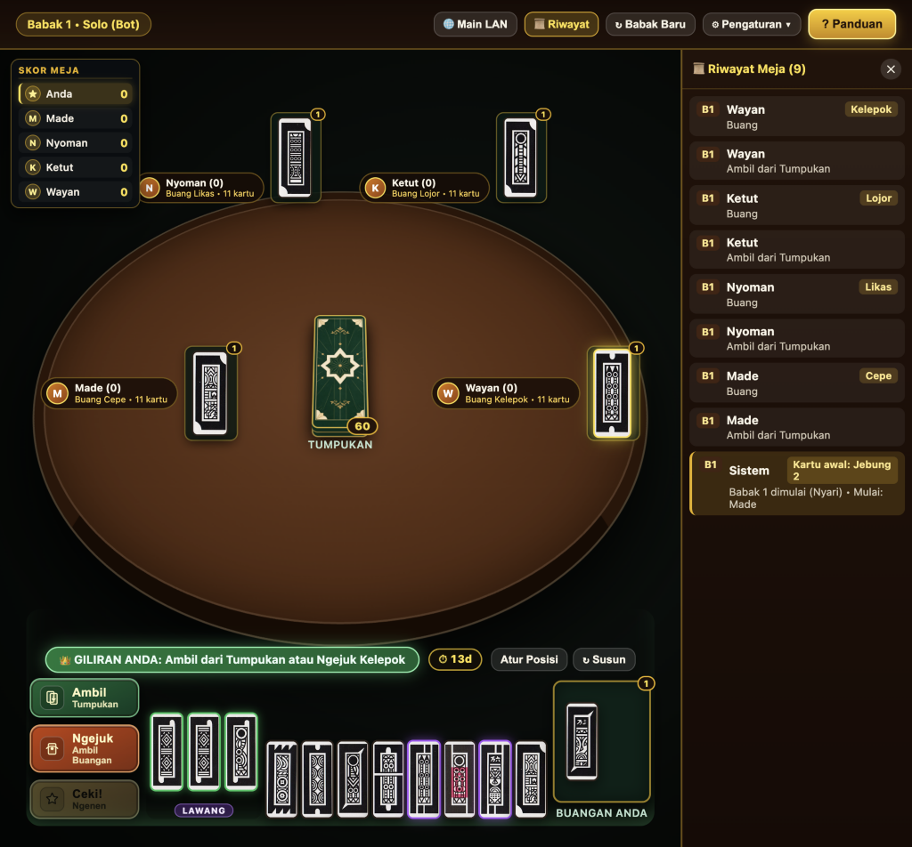

# Ceki Bali

Permainan kartu tradisional **Ceki Bali** 5 pemain dengan dukungan **Solo vs Bot** dan **LAN Multiplayer** (Web, macOS, Windows, Steam Deck, dan Mobile Landscape).

🎮 **Main Langsung di Browser**: https://archimades27.github.io/ceki-bali/  
📦 **Download Installer (macOS / Windows / Steam Deck)**: [Releases v1.0.0](https://github.com/archimades27/ceki-bali/releases/tag/v1.0.0)



## Fitur Utama

- **5 Pemain di Meja Kayu**: 1 pemain manusia + 4 kursi lawan (Bot AI atau pemain lain via Wi-Fi/LAN lokal).
- **Mode Solo & LAN Multiplayer**:
  - **Host & Join langsung dari aplikasi**, lengkap dengan tombol salin URL LAN, validasi nama pemain unik, dan pengisian kursi kosong otomatis dengan Bot.
  - **Timer Giliran Kustom** (default 15 detik, dapat diatur saat memulai game LAN/Solo) dan notifikasi jelas untuk pemain yang sedang aktif.
  - **Spawn Awal Acak**: Pemain pertama yang memulai babak dipilih secara acak.
- **Aturan Resmi Ceki Bali**:
  - **120 Kartu** (30 jenis kartu tradisional Bali × 4).
  - **Susunan Kartu (Meld)**:
    - **Soca**: 3 kartu kembar persis.
    - **Serigat**: 3 kartu berbeda dalam 1 keluarga (*se-ekor*).
    - **Lawang**: 2 kartu kembar + 1 kartu sekeluarga.
  - **Syarat Kemenangan (Ngenen / Ceki)**:
    - Wajib memiliki minimal **2 Soca** (total 4 susunan / 12 kartu).
    - **Ngenen** hanya sah dari **kupakan kartu Tumpukan** (tidak bisa menang langsung dari kartu buangan / *Ngejuk*).
    - **Mecari** (1 Soca di 11 kartu): hanya bisa menang dengan kartu yang sama persis untuk membentuk Soca ke-2.
    - **Mejaga** (≥ 2 Soca di 11 kartu): dapat menang (*Kupak Nyari*) dengan kartu apa saja dalam keluarga yang sama.
    - **Ngandang**: notifikasi menyala khusus saat pemain dalam kondisi Mecari/Mejaga membuka (*ngupak*) kartu kemenangannya sendiri.
- **Inspeksi Kartu & Antarmuka Responsif**:
  - Klik tumpukan buangan pemain mana pun untuk melihat seluruh kartu yang sudah dibuang.
  - Mendukung mode **landscape di iPhone / mobile**, drag & drop susunan kartu, audio efek, serta kontroler **Steam Deck / Gamepad**.

## Menjalankan Secara Lokal

Prasyarat: **Node.js 22+** (untuk `--experimental-strip-types` pada server LAN & unit test).

```bash
npm install

# Mode pengembangan (Vite dev server)
npm run dev

# Menjalankan unit test aturan kartu & engine
npm test

# Build produksi
npm run build

# Menjalankan server LAN multiplayer
npm run lan
```

## Build Paket Aplikasi (macOS, Windows, Steam Deck)

- **macOS (`.app` & `.dmg`)**:
  ```bash
  ./macos/build_dmg.sh
  ```
- **Windows (`.exe` Installer & Portable `.zip`)**:
  ```bash
  ./windows/build_windows.sh
  ```
- **Steam Deck (`.tar.gz`)**:
  ```bash
  ./steamdeck/build_steamdeck.sh
  ```
